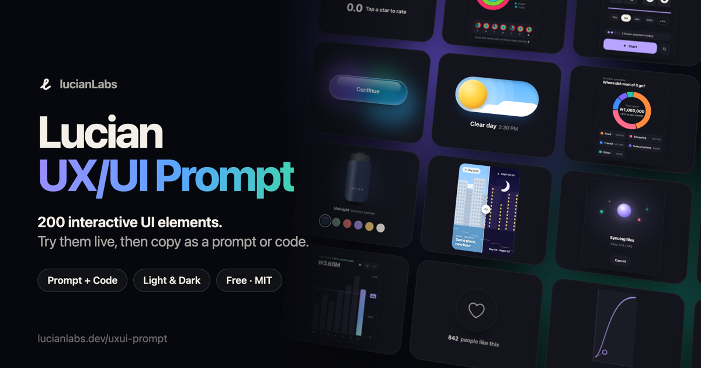

[🇰🇷 한국어](README.ko.md) · [🇺🇸 English](README.md)

# Lucian UX/UI Prompt



바로 눌러 볼 수 있는 UI 요소 400개를 모았습니다. 버튼과 차트부터 앱 화면까지 인터페이스 200개, 히어로·가격표부터 스크롤·텍스트 모션까지 웹사이트 섹션과 애니메이션 200개입니다. 마음에 드는 요소는 AI 프롬프트나 실제 코드로 가져가세요. 모든 요소가 라이트·다크 테마, 마우스·터치·키보드 조작, 동작 줄이기 설정을 지원하고, 외부 라이브러리는 쓰지 않습니다.

**갤러리: [lucianlabs.dev/uxui-prompt](https://lucianlabs.dev/uxui-prompt/)**

## 구성

요소 번호에 따라 두 컬렉션으로 나뉩니다.

| 컬렉션 | 번호 | 분류 |
| --- | --- | --- |
| **애니메이션**: 웹사이트 섹션과 모션(새로 추가) | 201–400 | 텍스트 모션 · 히어로·배경 · 내비게이션 · 스크롤 모션 · 섹션·콘텐츠 · 소셜 증명 · 커머스·가격 · 폼·입력 · 앱 화면 · 빌더 도구 · 커서·호버 · 프로모션·보상 · 데이터 모션 |
| **인터페이스**: UI 부품과 업무 화면 | 001–200 | 버튼 · 토글·선택 · 입력·검색 · 메뉴·탭 · 카드·콘텐츠 · 로그인·가입 · 알림·피드백 · 로딩·진행 · 빈·오류 상태 · 위젯·차트 · 공간·일정·디자인 도구 · 문서·데이터 편집 · 분석·데이터 · 작업·시스템 |

갤러리의 **전체**에서는 애니메이션 컬렉션이 먼저 나오고 인터페이스가 이어집니다. 위쪽에서 컬렉션을 바꾸거나 분류로 좁힐 수 있고, 한국어와 영어 모두로 검색할 수 있습니다.

## 사용법

1. 갤러리에서 요소를 직접 눌러 보세요. 화면에 보이면 스스로 시연하고, 언제든 직접 조작할 수 있습니다. 타일을 열거나 **릴스** 버튼을 누르면 전체 화면으로 넘겨 볼 수 있습니다.
2. **프롬프트 복사**를 누르세요. 요소의 실행 코드 전체와 적용 지침이 함께 들어 있습니다.
3. Claude Code, Cursor, Codex 같은 AI 코딩 도구에 붙여넣고 `[삽입 위치]`(바꿀 요소가 있으면 `[교체 대상]`도)를 채워 보내면 됩니다.

AI는 프로젝트의 프레임워크와 스타일, 테마 방식을 먼저 확인한 뒤 요소를 컴포넌트로 옮깁니다. `--ux-*` 색 토큰은 프로젝트의 테마 변수에 연결하고, 바꾼 파일과 확인하지 못한 항목을 알려 줍니다.

직접 옮기고 싶다면 **코드 복사**로 HTML·CSS·JS 원본을 받거나, **코드 파일 받기**로 테마 전환 버튼이 있는 단독 HTML 파일을 저장하세요. 특정 요소는 `https://lucianlabs.dev/uxui-prompt/#001`처럼 번호로 바로 연결할 수 있습니다.

## AI 에이전트에서 쓰기

[lucian-uxui 스킬](https://github.com/Seokwoooo/lucian-uxui)을 설치하면 에이전트가 직접 요소를 찾아 프로젝트에 옮겨 넣습니다.

```sh
npx skills add Seokwoooo/lucian-uxui
```

설치한 뒤 "카페 랜딩 페이지 만들어줘. lucian-uxui 스킬로 여기 요소를 우선 써줘."처럼 요청하면 됩니다. 스킬이 읽는 데이터는 [`api/v1/`](api/v1)에 있습니다. `src/elements`에서 생성한 파일이고, `https://lucianlabs.dev/uxui-prompt/api/v1/`에서도 받을 수 있습니다.

## 로컬에서 실행

Node.js만 있으면 됩니다. 설치할 패키지는 없습니다.

```sh
git clone https://github.com/Seokwoooo/lucian-uxui-prompt.git
cd lucian-uxui-prompt
node src/build.mjs
open prompt-uxui-lab/index.html
```

빌드는 요소 파일 형식을 모두 검사한 뒤 갤러리 전체를 HTML 파일 하나로 만듭니다.

## 요소 파일 형식

요소 하나는 파일 하나, `src/elements/NNN-slug.html`입니다. 번호 `001`–`200`은 인터페이스 컬렉션, `201`부터는 애니메이션 컬렉션입니다.

```html
<!-- @meta {"title":"…","category":"버튼","summary":"…","hint":"…","shape":"square","tags":["button"]} -->
<!-- @demo [["wait",400],["tap",".u001-btn"],["wait",1200]] -->
<!-- @en {"title":"…","summary":"…","hint":"…","map":[["계속하기","Continue"]]} -->
<style>.u001{…} .u001-btn{…}</style>
<div class="ux u001">…</div>
<script>(() => { const root = document.currentScript.previousElementSibling; … })();</script>
```

- `@meta`: 제목, 분류, 설명, 안내 문구입니다. 원문 언어는 한국어이고, `category`는 [`src/build.mjs`](src/build.mjs)에 적힌 분류 중 하나여야 합니다. 선택 항목으로 `shape`(`square` 또는 세로로 긴 `tall` 타일), `hue`·`hue2`(타일 빛 번짐 색, 없으면 분류 기본색), `fluid`(요소 폭이 컨테이너를 따름)를 쓸 수 있습니다.
- `@demo`: 자동 시연 단계입니다. `wait`, `tap`, `hold`, `hover`, `leave`, `glide`, `drag`, `key`, `type`, `erase`, `set`, `scroll`, `reset`, `js`를 쓸 수 있습니다.
- `@en`: 영어 제목과 설명, 그리고 요소 코드 속 문구를 영어로 바꾸는 문자열 표입니다.
- 모든 CSS 선택자는 `.uNNN` 안에서만 동작하고, `@property` 이름은 `--uNNN-`으로 시작합니다. 스크립트는 `document.currentScript`로 자기 루트를 찾습니다. 그래서 요소끼리 서로 간섭하지 않습니다.
- 색은 [`src/tokens.css`](src/tokens.css)의 `--ux-*` 토큰만 씁니다. 토큰에는 라이트와 다크 값이 모두 들어 있습니다.
- [`src/order.json`](src/order.json)은 컬렉션 안에서 보여 주는 순서입니다. 완성도가 높은 요소를 앞에 둡니다. 여기에 적힌 컬렉션은 모든 요소가 한 번씩 들어가야 합니다.

`node src/build.mjs`는 이 규칙을 어긴 파일을 거부합니다.

## 라이선스

[MIT](LICENSE) © 2026 Seokwoooo. 개인·상업 프로젝트에 자유롭게 쓸 수 있습니다. 갤러리에서 복사한 코드 맨 위에는 출처와 라이선스를 적은 주석 한 줄이 붙어 있으니, 파일에 남겨 주세요.
